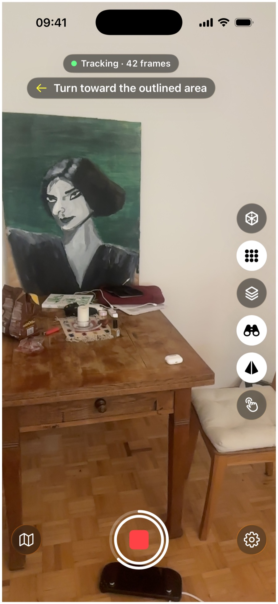
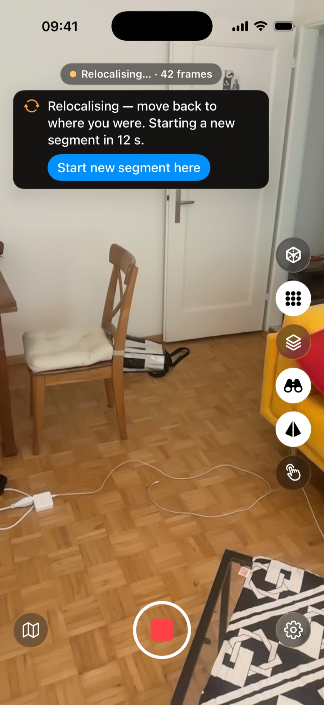

# Capturing a scene

Capture Guide is built for scenes: rooms and other spaces, indoors or outdoors. It has no mode for small objects.

## Keyframes

A 3D reconstruction needs every part of the scene in several photos taken from different places. The app keeps a photo, a keyframe, when your view has changed enough since the last one.

<figure class="callouts" markdown>

1. [**Status pill**](#walking-pace-and-distance): counts keyframes. Stops rising when frames blur.
   { data-anchor="status-pill" data-side="r" }
2. [**White border**](#keyframes): flashes once for each keyframe.
   { data-anchor="keyframe-pulse" data-side="l" }
3. [**Hand button**](#keyframes-by-hand): turns on manual capture; you take the keyframes.
   { data-anchor="rail-manual" data-side="r" }

</figure>

- **Move between shots**: standing still adds nothing.
- **Don't retrace yourself**: if you stand close to an earlier keyframe and look the same way, the app skips the frame; from a different direction it counts again.

??? note "Details"
    - A turn on the spot adds a frame now and then, which keeps the keyframes linked.
    - By default a keyframe is taken when the view shares about 60 % or less with the last one ([Photo overlap](getting-started.md#other-settings) in Settings, behind the gear at the bottom right of the camera screen), or after a turn of about 10 degrees.
    - "The same way" means within about 10 degrees. "Close" scales with how far away the surfaces are, from 5 cm up to 30 cm.

## Walking pace and distance

Walk slowly and keep the phone steady. Turning fast smears the image, worse in a dim room, and smeared frames are skipped: the count in the pill stops rising until you slow down. If you move too fast for a sharp photo while the app wants one, a yellow tortoise pill "Slow down" replaces the guidance line, with a soft tap. It goes away once a sharp photo is taken. The app does not enforce a distance to the surfaces; the guidance and the keyframe flashes show whether the phone is picking up your view.

??? note "Details"
    - A dim room makes the smear worse because the camera exposes longer.
    - The app measures how much each frame smears. A frame that smears by more than about 2 pixels is skipped.

## Angles

- Look at the same wall or piece of furniture from more than one side.
- Step sideways rather than only turning.
- For the floor and ceiling, tilt the phone down or up while you walk.

The guidance shows a yellow camera where to stand and the outlined area to point at, as described in [Reading the guidance](guidance.md).

??? note "Details"
    - A step changes the view of nearby surfaces far more than a turn does, and that change in angle is one of the triggers for a new keyframe.
    - The quality dots and the ring count a turn on the spot as no new direction ([Quality dots](guidance.md#quality-dots)).

## Light

Bright, even light gives sharp frames; in dim light turn the lights on or move more slowly. Light that stays the same through the whole capture gives a more even result than light that changes as you go.

## What reconstructs poorly

- **Mirrors, glass and very shiny surfaces**: what they show changes with your viewpoint. Expect weak results there.
- **Moving people or traffic**: a reconstruction assumes the scene stands still, so anything that moves can show up as smears. Wait for it to pass when you can.

## Keyframes by hand

Turn on manual capture with the hand button on the side rail: the automatic keyframes stop, and while you record, a round shutter button appears above the rail. Tap it to take a keyframe from the next sharp frame. If it flashes red, hold the phone still and try again.

??? note "Details"
    The button flashes red when no sharp frame arrives within about half a second.

## When tracking is lost

The app only captures while the phone's tracking (Apple's ARKit) works normally. If tracking drops, for example from fast motion or a scene with too little detail, capture pauses and the phone tries to find its place again.

<figure class="callouts" markdown>

1. [**Status pill**](#when-tracking-is-lost): the tracking state.
   { data-anchor="status-pill" data-side="l" }
2. [**Relocalising banner**](#when-tracking-is-lost): walk back. Counts down to a new segment.
   { data-anchor="banner-warning" data-side="r" }
3. [**Start new segment here**](#when-tracking-is-lost): continue without going back.
   { data-anchor="segment-button" data-side="l" }

</figure>

To get going again, walk back to where you were: if the phone recognises the place, capture continues in the same segment. Otherwise a new segment starts, and the guidance starts over.

??? note "Details"
    - A segment is one continuous capture in one coordinate system. The phone starts a new one when it has lost the old coordinate system. Tap "Start new segment here" during the countdown when you do not want to go back.
    - The banner with an orange arrows symbol reads "Relocalising — move back to where you were. Starting a new segment in N s." After 15 seconds without finding the place, capture continues in a new segment.
    - While tracking restarts, the banner reads "Tracking restarting — a new segment starts when tracking returns.", and a second banner with a yellow tortoise reads "Move the phone slowly around to start tracking."
    - Each segment is saved in its own folder.
    - In a new segment the old reconstruction is no longer shown, and the ring around Stop comes back once the segment has its first coverage figure.
    - A capture with more than one segment shows "2 seg" (or more) on its card in your captures, and its Frames tab lists the segments one by one.

## An indoor room

Walk the room and follow the guidance until it reports "Room covered"; then it has no further target. With LiDAR, grey diagonal hatching marks surfaces the phone sees that the reconstruction does not cover yet, and disappears once you have captured them. Without LiDAR, or with Live splat set to "Off", there is no hatching: use the coloured quality dots (how well each part is covered) and the map instead.

## An outdoor walk

Set "Scene" to "Outdoor" in Settings before you tap Record; it can't be changed during a capture. The engine then trains with a sky background and uses larger cells. Moving people and traffic cause the smears described [above](#what-reconstructs-poorly).

??? note "Details"
    Beyond the range of LiDAR, and on phones without it, the phone estimates depth from the image alone, so distant surfaces still get guidance.

## Keeping the screen on

The screen does not dim or lock while a capture runs. After you tap Stop, the usual timeout returns once the capture is saved.
