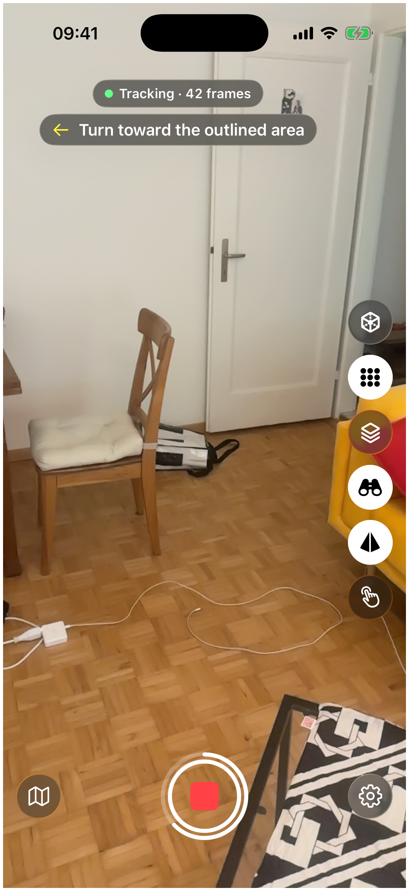
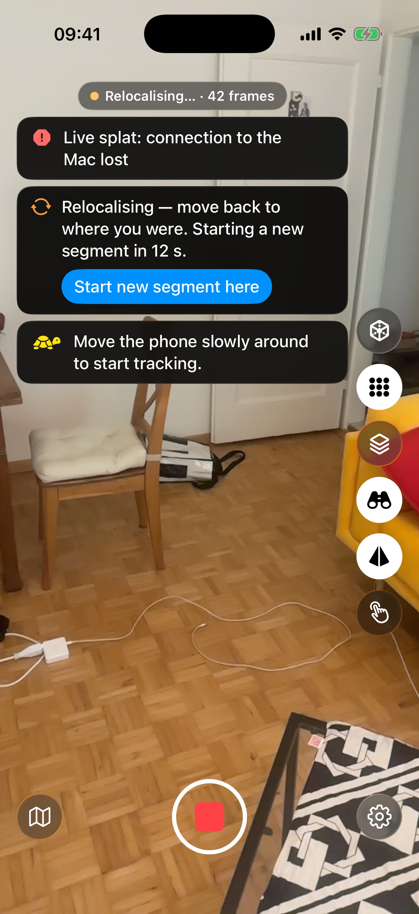

# Capturing a scene

How to record a scene with Capture Guide. The app is built for scenes: rooms and other spaces, indoors or outdoors. It has no mode for small objects.

## Overlap and viewpoint variety

A 3D reconstruction needs every part of the scene in several photos taken from different places. Two rules follow from that.

Move between shots. The app takes a keyframe (a photo it keeps for the reconstruction) when the view has changed enough against the last one. By default that means the new view shares about 60% or less with the last keyframe ("Photo overlap" in Settings, which opens with the gear at the bottom right of the camera screen), or you have turned the phone by about 10 degrees. Standing still adds nothing. A turn on the spot does add a frame every so often, which keeps the keyframes linked, but a step sideways gives the reconstruction the new angle it needs.

Do not retrace yourself. If you stand close to an earlier keyframe and look the same way, within about 10 degrees, the app skips the frame. "Close" scales with how far away the surfaces are: from 5 cm up to 30 cm. Come back to a spot from a different direction and it counts again.

## Walking pace and distance

Walk slowly and keep the phone steady. The app measures how much the image smears: the faster you turn the phone, the more blur, and a dim room makes it worse because the camera exposes longer. A frame that smears by more than about 2 pixels is skipped, and the frame count in the pill at the top stops rising. Slow down, and it picks up again.

The app does not enforce a distance to the surfaces. Check the guidance and the keyframe flashes to see whether the phone is picking up your view.

## Angles

Look at the same wall or piece of furniture from more than one side. A sideways step changes the view of nearby surfaces far more than a turn does, and that change in angle is one of the triggers for a new keyframe. For the floor and ceiling, tilt the phone down or up while you walk.

The guidance helps with this: it shows a yellow camera where to stand and the outlined area you should point at. [Reading the guidance](guidance.md) explains it.

## Light

Bright, even light gives sharp frames. In a dim room the camera exposes longer, so the same movement smears more and more frames are skipped for blur. Turn on the lights or move more slowly. In general, steady lighting through the whole capture gives a more even result than light that changes as you go.

## Reflective surfaces

In general, mirrors and glass reconstruct poorly, and so do other very shiny surfaces, because what they show changes with your viewpoint. Expect weak results there.

## Motion in the scene

A reconstruction assumes the scene stands still. In general, anything that moves while you capture, such as people or traffic, can show up as smears in the result. Wait for it to pass when you can.

## Keyframes by hand

If you want full control, turn on manual capture with the hand button on the side rail. The automatic keyframes stop, and while you record, a round shutter button appears above the rail. Tapping it takes a keyframe from the next sharp frame. If none arrives within about half a second, the button flashes red; hold the phone still and try again.

{ loading=lazy }
/// caption
Screenshot pending: a white border around the screen at the moment of a keyframe.
///

## When tracking is lost

The app only captures while the phone's tracking (Apple's ARKit) is working normally. If tracking drops, for example from fast motion or a scene with too little detail, capture pauses and the phone tries to find its place again.

- While it searches, a banner with an orange arrows symbol reads "Relocalising — move back to where you were. Starting a new segment in N s." Walk back to where you were. If the phone recognises the place, capture continues in the same segment.
- If it has not found the place after 15 seconds, or you tap "Start new segment here", capture continues in a new segment. While tracking restarts, the banner reads "Tracking restarting — a new segment starts when tracking returns.", and a second banner with a yellow tortoise reads "Move the phone slowly around to start tracking."

A segment is one continuous capture in one coordinate system. The phone starts a new one when it has lost the old coordinate system. Each segment is saved in its own folder, and the guidance starts over: the old reconstruction is no longer shown, and the ring around Stop comes back once the new segment has its first coverage figure. A capture with more than one segment shows "2 seg" (or more) on its card in your captures, and its Frames tab lists the segments one by one. You can tap "Start new segment here" during the countdown when you do not want to go back.

{ loading=lazy }
/// caption
Screenshot pending: the dark relocalising banner under the status pill, with its orange symbol, the countdown and the "Start new segment here" button.
///

## An indoor room

Walk the room and follow the guidance. The app shows a yellow camera where to stand next and an outlined area to point at. When it reports "Room covered", it has no further target.

With LiDAR, grey diagonal hatching appears on surfaces the phone sees that the reconstruction does not cover yet. It disappears once you have captured them. Without LiDAR, or with Live splat set to "Off", there is no hatching, so rely on the coloured quality dots (they show how well each part of the scene is covered) and the map.

## An outdoor walk

Before you tap Record, set "Scene" to "Outdoor" in Settings. The engine then trains with a sky background and uses larger cells. The setting can't be changed during a capture.

Beyond the range of LiDAR, and on phones without it, the phone estimates depth from the image alone, so distant surfaces still get guidance.

Moving people and traffic add the problem described above.

## Keeping the screen on

While a capture runs, the phone does not dim or lock the screen. After you tap Stop, the usual screen timeout applies again as soon as the phone has finished saving the capture.
