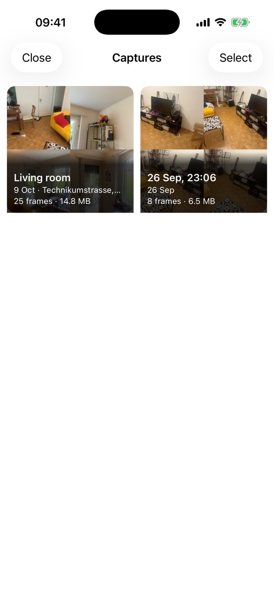
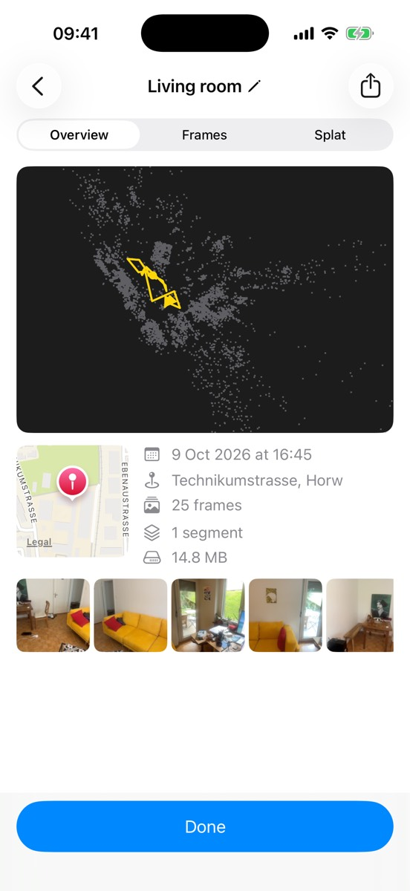
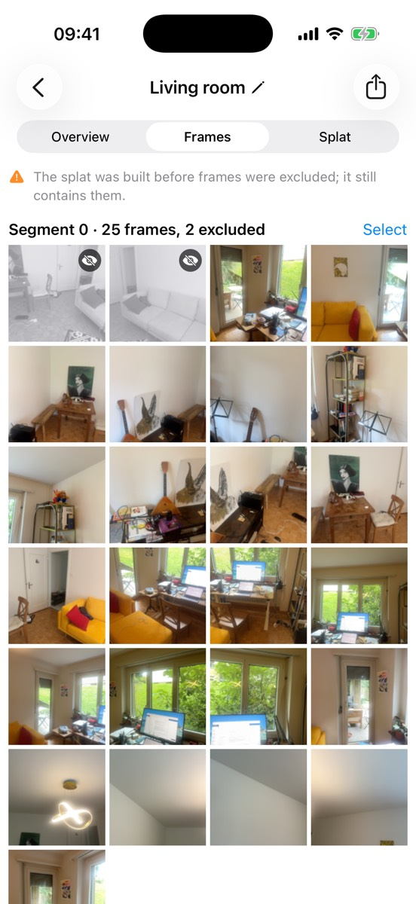
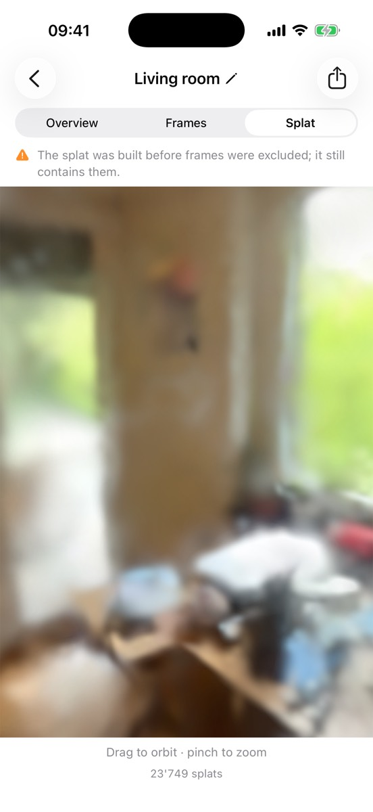
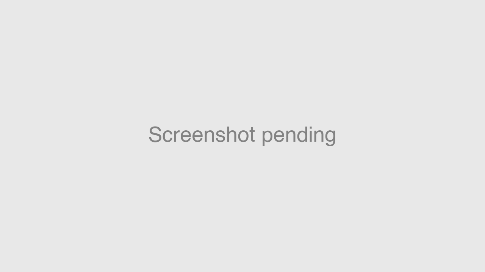
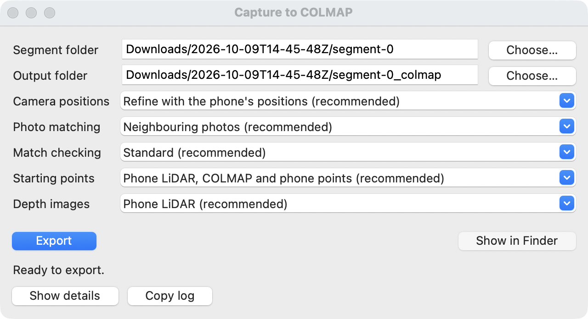

# Your captures and exporting

How to find your captures on the iPhone, look through them, share them, and train one into a 3D Gaussian Splatting model on your computer with the free Spirula Studio app.

## Your captures

Tap the picture at the bottom left of the camera screen to see your captures, newest first. Each card shows four photos from the capture with its name, date and place, the number of frames and its size. "Close" at the top left takes you back to the camera.

- **Names**: a capture is named after its place and time, for example "Main Street, Lucerne · 16:45", or after its date and time when there is no place. To rename it, open it and tap its name at the top.
- **Deleting**: tap "Select", tap the captures you want to remove (a check mark appears at the bottom right of each), then tap "Delete" at the bottom and confirm. This cannot be undone.
- At the larger accessibility text sizes the cards are shown one per row.

{ width="320" loading=lazy }
/// caption
Your captures, newest first.
///

## Looking at a capture

Tap a card to open it. The back button at the top left takes you back to your captures; it shows a chevron, with the word "Captures" on iOS 18. The share button at the top right is described [below](#getting-captures-off-the-phone). The capture has three tabs.

**Overview**: the capture seen from above. Grey points are the surfaces, and a coloured line from a dot to an arrowhead is the path you walked, one colour per segment. Pinch to zoom, drag to move, double-tap to reset. A capture without saved camera positions shows "No top view" instead. Below it, the facts follow one per row: date and time, place, number of frames, number of segments and size. A small square map with a pin sits next to them and shows where you were; at the larger accessibility text sizes it sits above them, and a capture without a recorded place has no map. A strip of photos follows. "Done" at the bottom takes you back to the camera.

**Frames**: every keyframe, segment by segment. Tap one to see it large; "Exclude" leaves it out of the export, "Restore" brings it back. To change several at once, tap "Select" above the grid, tap the frames, then "Exclude" or "Restore" at the bottom. Excluded frames are greyed out and marked with a crossed-out eye. Nothing is deleted: the photo stays on the phone, and only the list of photos that exports read (`transforms.json`) leaves it out. If the 3D model was built before you excluded frames, a note says that it still contains them.

**Splat**: the 3D model the phone built, if there is one. Drag to orbit, pinch to zoom. When more than one segment has a model, a picker above it chooses the segment. Without a model, the tab says why: "Live splat was off", "Built on the Mac" or "No splat yet".

{ width="320" loading=lazy }
/// caption
The Overview tab.
///

{ width="320" loading=lazy }
/// caption
The Frames tab; the first two frames are excluded.
///

{ width="320" loading=lazy }
/// caption
The Splat tab.
///

## Where your captures are stored

Every capture is saved on the phone while you record, with nothing to switch on. Open the Files app and go to On My iPhone, then "Capture Guide". Each capture is a folder named after its start time in UTC, for example `2026-10-07T12-30-00Z`. Inside it you find:

- `capture.json`: the capture's name, place and which frames you excluded.
- `thumb-v2.jpg`: the picture on the capture's card. Captures from older versions of the app also have a `thumb.jpg`, which you can ignore.
- `overlay-metrics.jsonl`: a working file you can ignore.
- One folder per segment: `segment-0`, `segment-1` and so on. A segment is one continuous stretch of capture in one coordinate system ([Capturing a scene](capturing.md#when-tracking-is-lost) explains when a new one starts).

A segment folder holds:

- `images/`: the full-resolution photo of every keyframe. The photos are stored as the camera sensor records them, turned sideways; the app shows them upright, and training software uses them as they are.
- `transforms.json`: where the camera was for each photo, and its lens settings. Frames you excluded are left out of it. Once you exclude a frame, `transforms.unfiltered.json` keeps the full list.
- `depth/`: the LiDAR depth maps. The folder exists in every segment and stays empty without LiDAR.
- `points.ply`: a sparse cloud of coloured points the phone tracked.
- `splat.ply`: the 3D model (made of many splats) the phone trained while you captured, written after you tap Stop or when a new segment starts. It is there only for captures with Live splat on "This iPhone".
- `overlap_audit.json` and `wire/`: working files of the app that you can ignore.

Tap Stop before you leave the app. While you capture, the photos are written straight away, but the list in `transforms.json` is updated after every tenth keyframe and when a segment ends. Stopping updates it too. If the app closes in between, the newest photos stay in `images/` but are missing from the list. Sometimes a new segment starts just before Stop. It leaves an empty `segment-N` folder behind that you can skip.

{ loading=lazy }
/// caption
Screenshot pending: the Files app at On My iPhone, "Capture Guide", with one dated capture folder open and its `segment-0` folder showing its files.
///

## Getting captures off the phone

The quickest way is the share button at the top right of an open capture. It packs the capture into one zip file, without the app's working copies in `wire/`, and opens the iOS share sheet: send it with AirDrop to your Mac, save it to Files, or mail it. Unzipped, it gives the capture folder with its segment folders, ready for Capture to COLMAP below. The button waits until the capture is saved on the iPhone.

{ loading=lazy }
/// caption
Screenshot pending: the iOS share sheet after tapping the share button, with the capture's zip file and AirDrop.
///

The folder is also shared with the Files app, so the usual iOS ways work. Press and hold a capture folder in Files to copy it to iCloud Drive or another location. With the phone connected to a Mac by cable, the Capture Guide folder also shows in Finder under the phone's file sharing. A capture can be large, because it holds full-resolution photos.

Copy the whole capture folder, or at least the segment folders you want. A segment folder has to stay in one piece, because the photos and `transforms.json` belong together.

## Choosing a segment

Each segment has its own coordinate system, so you train each one separately; they cannot be joined into one model. In general, start with the segment that has the most photos.

## Turning a segment into a COLMAP model

Many 3DGS trainers, Spirula Studio among them, read a COLMAP model (a folder with the photos and the camera positions in a standard layout). The phone writes its own layout instead, so you convert it with the Capture to COLMAP app. This is the default route. If you want to skip the conversion, see "The quick route" below.

Download `CaptureToColmap-macos-arm64.zip` from the [latest release](https://github.com/irc-hslu/capture-guide-docs/releases/latest) and unzip it. It runs on a Mac with Apple Silicon and macOS 14 or newer; a Windows version is planned. The app is not signed, so macOS blocks it at first. Double-click the app once and click "Done" on the warning that macOS cannot check it for malicious software. Then open System Settings > Privacy & Security, scroll down to the message that "Capture to COLMAP was blocked", click "Open Anyway" and confirm. From then on it opens normally.

To use it:

1. Open Capture to COLMAP.
2. Next to "Segment folder", click "Choose…" and pick one segment folder, such as `segment-0`.
3. "Output folder" is filled in with the same name plus `_colmap`, next to the segment. Change it with "Choose…" if you like.
4. Leave "Camera positions" and "Photo matching" on their recommended entries. "Refine with the phone's positions (recommended)" matches the photos to each other, starting from where the phone thought the camera was, and keeps the result at real-world scale. The other entry, "Use the phone's positions as they are", skips that fit. "Neighbouring photos (recommended)" compares each photo with the ones taken around it. "Every photo with every other (slow; short captures only)" compares all of them. "Match checking" can stay on "Standard (recommended)". If many photos are missing from the result, export again with "Relaxed, checked against the phone's tracking (more photos, slower)". It places more photos and checks them more thoroughly against the phone's positions, which takes longer.
5. Leave "Starting points" on its recommended entry too. It writes `seed.ply`, a cloud built from the phone's depth sensor and the phone's own points, together with COLMAP's points, coloured from your photos. Spirula Studio can start training from it.
6. Leave "Depth images" on Phone LiDAR. It writes the depth sensor's readings next to the photos, which some trainers can use as a guide for the geometry.
7. Click "Export". The app shows the elapsed time and a status line. "Show details" opens the log.
8. When the status line says "Done", click "Show in Finder" to open the output folder.

The output folder holds:

- `images/`: copies of the photos, so the folder works on its own and you can move it.
- `sparse/0/`: the COLMAP model.
- `seed.ply`: the starting points for training (absent when Starting points is None or nothing could be built).
- `depths/`: the phone's depth sensor readings for each photo (absent when Depth images is None or the capture has no depth sensor data).
- `work/`: the app's working files, which the trainer does not need.

Photos that the app cannot match well enough are left out of the model. Exporting the same segment again replaces the earlier export.

{ loading=lazy }
/// caption
Screenshot pending: the Capture to COLMAP window with a segment folder chosen, the output folder filled in, all four dropdowns on their recommended entries and the "Export" button visible.
///

## Training

[Spirula Studio](https://github.com/harry7557558/spirula-studio) is a free, open-source app that trains a 3D Gaussian Splatting model from your photos. It has a desktop app for Macs with Apple Silicon, Windows and Linux. Download it from its [releases page](https://github.com/harry7557558/spirula-studio/releases). The downloaded Mac build is signed without an Apple developer certificate, so macOS may block the first open. If it does, the same "Open Anyway" step in Privacy & Security applies as for Capture to COLMAP above.

There are two routes. Both work.

### Default: through Capture to COLMAP

1. Convert the segment with Capture to COLMAP, as described above. The conversion refines the camera positions the phone recorded.
2. Open the output folder, the one with `images/` and `sparse/0/`, in Spirula Studio.
3. Choose `seed.ply` from the output folder as the seed point cloud ("Seed point cloud PLY"). This needs Spirula Studio 2026.10.6 or newer; with an older version, skip this step. A long capture can give a `seed.ply` with more than a million points. You don't need to do anything about it: Spirula Studio's source code shows that it then starts from a random subset as large as its splat limit (one million by default), and in a test on one capture a cloud thinned to 300,000 points trained nearly as well as the full one.
4. To let Spirula Studio use the depth images, set its depth supervision weight above 0 (command line: `--depth-supervision-weight 0.1`); at its default of 0 they are ignored. In our tests they placed surfaces at the measured distance and removed see-through spots in an indoor capture; in an outdoor capture they did not change how the trained scene looked from new viewpoints.
5. Start training and watch the preview until it looks good, then save the result as a `.ply` file and open it in a splat viewer.

### The quick route: straight from the phone's folder

1. Open a segment folder, such as `segment-0`, directly in Spirula Studio. It reads the segment's `transforms.json` and `points.ply`, so there is no conversion step.
2. Start training and save the result as in the default route.

This route trains on the camera positions as the phone recorded them and skips the refinement that Capture to COLMAP does.

For the exact buttons, see the [Spirula Studio project page](https://github.com/harry7557558/spirula-studio). Other 3DGS trainers that read COLMAP also work from the same output folder. In general, a computer can use more splats and larger images than the phone's engine does, so the result tends to be cleaner than the `splat.ply` from the phone.

You can also open the phone's `splat.ply` directly in a splat viewer that reads `.ply` files, which is a quick check of what the phone built.
