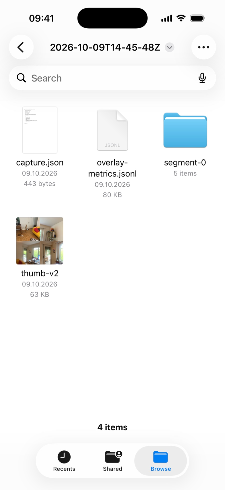
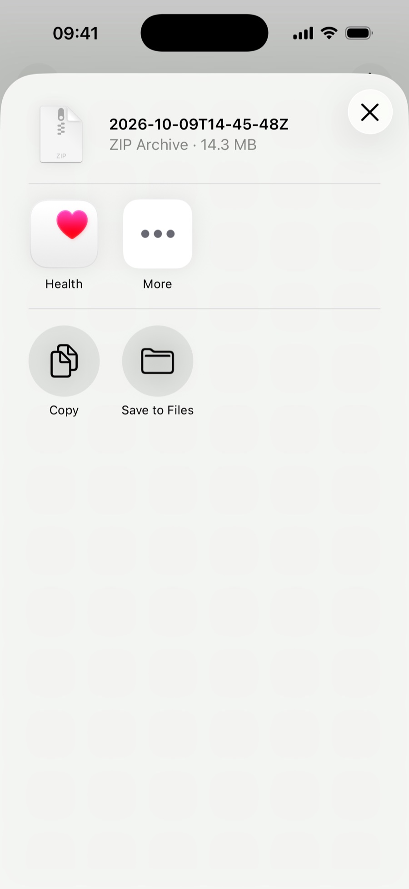
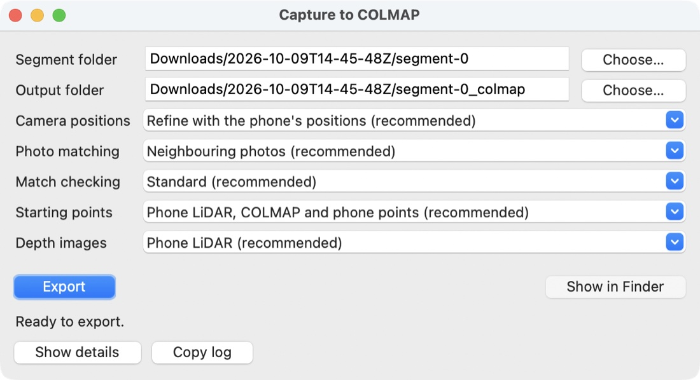

# Your captures and exporting

How to find your captures on the iPhone, get them onto your computer and train one into a 3D Gaussian Splatting model with the free Spirula Studio app.

## Your captures

Tap the picture at the bottom left of the camera screen. Your captures appear as cards, newest first.

<figure class="callouts" markdown>

1. [**Close**](#your-captures): back to the camera.
   { data-anchor="library-close" data-side="l" }
2. [**Select**](#your-captures): pick captures to delete.
   { data-anchor="library-select" data-side="r" }
3. [**Photos**](#looking-at-a-capture): four photos from the capture. Tap to open it.
   { data-anchor="card-collage" data-side="l" data-at="center" }
4. [**Name**](#your-captures): place and time, or date and time.
   { data-anchor="card-name" data-side="l" }
5. [**Date and place**](#your-captures): when and where you captured.
   { data-anchor="card-date" data-side="r" }
6. [**Frames and size**](#your-captures): number of keyframes and space on the phone.
   { data-anchor="card-frames" data-side="l" }

</figure>

- **Rename**: open the capture and tap its name at the top.
- **Delete**: tap "Select", tap the captures, then "Delete" at the bottom, and confirm. This cannot be undone.

??? note "Details"
    - A name looks like "Main Street, Lucerne · 16:45".
    - While you select, a check mark appears at the bottom right of each chosen capture.

## Looking at a capture

Tap a card to open the capture. Each of its tabs has a section below.

<figure class="callouts" markdown>

1. [**Back**](#looking-at-a-capture): to your captures.
   { data-anchor="back" data-side="l" }
2. [**Share**](#getting-captures-off-the-phone): packs the capture into one zip file.
   { data-anchor="share" data-side="r" }
3. [**Tabs**](#looking-at-a-capture): Overview, Frames and Splat.
   { data-anchor="tab-picker" data-side="r" }
4. [**Top view**](#overview): surfaces and the path you walked, from above.
   { data-anchor="overview-topview" data-side="l" }
5. [**Map**](#overview): where you were.
   { data-anchor="overview-map" data-side="l" }
6. [**Facts**](#overview): date, place, frames, segments and size.
   { data-anchor="overview-facts" data-side="r" }
7. [**Done**](#overview): back to the camera.
   { data-anchor="done" data-side="l" }

</figure>

??? note "Details"
    The back button shows a chevron, with the word "Captures" on iOS 18.

### Overview

Grey points are the surfaces. A coloured line from a dot to an arrowhead is the path you walked, one colour per segment. Pinch to zoom, drag to move and double-tap to reset.

??? note "Details"
    - A capture without saved camera positions shows "No top view" instead.
    - A capture without a recorded place has no map.
    - A strip of photos follows the facts.

### Frames

The Frames tab lists every keyframe, segment by segment. Here you choose which frames the export leaves out.

<figure class="callouts" markdown>

1. [**Excluded frame**](#frames): greyed out, with a crossed-out eye.
   { data-anchor="frame-excluded" data-side="l" }
2. [**Frame**](#frames): tap to see it large.
   { data-anchor="frame-cell" data-side="r" data-at="center" }

</figure>

1. Tap a frame, then "Exclude" to leave it out of the export, or "Restore" to bring it back.
2. For several frames, tap "Select", tap the frames, then "Exclude" or "Restore" at the bottom.

??? note "Details"
    - Nothing is deleted. The photo stays on the phone; only `transforms.json`, the list of photos that exports read, leaves it out.
    - If the 3D model was built before you excluded frames, a note says that it still contains them.

### Splat

If the phone built no model, the tab says why: "Live splat was off", "Built on the Mac" or "No splat yet".

<figure class="callouts" markdown>

1. [**Splat tab**](#splat): the 3D model the phone built, if there is one.
   { data-anchor="tab-picker" data-side="r" }
2. [**3D model**](#splat): drag to orbit, pinch to zoom.
   { data-anchor="splat-view" data-side="l" data-at="center" }

</figure>

??? note "Details"
    When more than one segment has a model, a picker above it chooses the segment.

## Where your captures are stored

Every capture is saved on the phone while you record, with nothing to switch on. In the Files app, go to On My iPhone, then "Capture Guide". Tap Stop before you leave the app, so the list of photos is complete.

<figure class="callouts" markdown>

1. [**Capture folder**](#where-your-captures-are-stored): named after the start time in UTC.
   { data-anchor="capture-folder" data-side="r" }
2. [**capture.json**](#where-your-captures-are-stored): the name, the place and your excluded frames.
   { data-anchor="capture-json" data-side="l" }
3. [**Segment folder**](#segment-folders): photos and camera positions of one segment.
   { data-anchor="segment-folder" data-side="r" }
4. [**thumb-v2**](#where-your-captures-are-stored): the picture on the capture's card.
   { data-anchor="thumbnail" data-side="l" }

</figure>

??? note "Details"
    - A folder name looks like `2026-10-07T12-30-00Z`.
    - `overlay-metrics.jsonl` is a working file you can ignore. Captures from older versions of the app also have a `thumb.jpg`, which you can ignore too.
    - There is one folder per segment: `segment-0`, `segment-1` and so on. A segment is one continuous stretch of capture in one coordinate system ([Capturing a scene](capturing.md#when-tracking-is-lost) explains when a new one starts).
    - While you capture, the photos are written straight away, but the list in `transforms.json` is updated after every tenth keyframe and when a segment ends. Stopping updates it too. If the app closes in between, the newest photos stay in `images/` but are missing from the list.
    - Sometimes a new segment starts just before Stop. It leaves an empty `segment-N` folder behind that you can skip.

### Segment folders

- `images/`: the full-resolution photo of every keyframe.
- `transforms.json`: where the camera was for each photo, and its lens settings.
- `depth/`: the LiDAR depth maps.
- `points.ply`: a sparse cloud of coloured points the phone tracked.
- `splat.ply`: the 3D model the phone trained while you captured.

??? note "Details"
    - The photos are stored as the camera sensor records them, turned sideways. The app shows them upright, and training software uses them as they are.
    - Frames you excluded are left out of `transforms.json`. Once you exclude a frame, `transforms.unfiltered.json` keeps the full list.
    - `depth/` exists in every segment and stays empty without LiDAR.
    - `splat.ply` (the model is made of many splats) is written after you tap Stop or when a new segment starts. It is there only for captures with Live splat on "This iPhone".
    - `overlap_audit.json` and `wire/` are working files of the app that you can ignore.

## Getting captures off the phone

Tap the share button at the top right of an open capture. It packs the capture into one zip file and opens the iOS share sheet. Send it with AirDrop to your Mac, save it to Files, or mail it. Unzipped, the file gives the capture folder with its segment folders, ready for [Capture to COLMAP](#turning-a-segment-into-a-colmap-model).

<figure class="callouts" markdown>

1. [**Zip file**](#getting-captures-off-the-phone): the capture, without the working copies in `wire/`.
   { data-anchor="zip-file" data-side="l" }
2. [**Apps**](#getting-captures-off-the-phone): send the zip to another app or device.
   { data-anchor="share-apps" data-side="l" }
3. [**Save to Files**](#getting-captures-off-the-phone): keeps the zip in the Files app.
   { data-anchor="save-to-files" data-side="r" }

</figure>

??? note "Details"
    - The share button waits until the capture is saved on the iPhone.
    - A capture can be large, because it holds full-resolution photos.

### Other ways

The Capture Guide folder is shared with the Files app. Press and hold a capture folder there to copy it to iCloud Drive or another location. With the phone connected to a Mac by cable, the folder also shows in Finder under the phone's file sharing.

Copy the whole capture folder, or at least the segment folders you want; a segment folder has to stay in one piece, because the photos and `transforms.json` belong together.

## Choosing a segment

Each segment has its own coordinate system, so you train each one separately; they cannot be joined into one model. In general, start with the segment that has the most photos.

## Turning a segment into a COLMAP model

Many 3DGS trainers, Spirula Studio among them, read a COLMAP model: the photos and the camera positions in a standard layout. The Capture to COLMAP app converts a segment folder into one. This is the default route; [the quick route](#the-quick-route-straight-from-the-phones-folder) skips it.

### Install

Capture to COLMAP runs on a Mac with Apple Silicon and macOS 14 or newer.

1. Download `CaptureToColmap-macos-arm64.zip` from the [latest release](https://github.com/irc-hslu/capture-guide-docs/releases/latest) and unzip it.
2. Double-click the app once and click "Done" on the warning that macOS cannot check it for malicious software.
3. Open System Settings > Privacy & Security, scroll down to the message that "Capture to COLMAP was blocked", click "Open Anyway" and confirm. From then on it opens normally.

??? note "Details"
    - The app is not signed, so macOS blocks it at first.
    - A Windows version is planned.

### Converting

<figure class="callouts callouts--landscape" markdown>

1. [**Segment folder**](#converting): the segment to convert.
   { data-anchor="segment-folder" data-side="l" }
2. [**Output folder**](#converting): where the COLMAP model goes.
   { data-anchor="output-folder" data-side="l" }
3. [**Options**](#converting): five dropdowns, each with a recommended entry.
   { data-anchor="options" data-side="r" }
4. [**Export**](#converting): starts the conversion.
   { data-anchor="export-button" data-side="l" }
5. [**Status line**](#converting): what the app is doing.
   { data-anchor="status-line" data-side="l" }
6. [**Show details**](#converting): opens the log.
   { data-anchor="show-details" data-side="l" }
7. [**Show in Finder**](#converting): opens the output folder.
   { data-anchor="show-in-finder" data-side="r" }

</figure>

1. Open Capture to COLMAP.
2. Next to "Segment folder", click "Choose…" and pick one segment folder, such as `segment-0`.
3. "Output folder" is filled in with the same name plus `_colmap`, next to the segment. Change it with "Choose…" if you like.
4. Leave "Camera positions", "Photo matching", "Match checking", "Starting points" and "Depth images" on their recommended entries.
5. Click "Export" and wait. The app shows the elapsed time.
6. When the status line says "Done", click "Show in Finder".

Photos that the app cannot match well enough are left out of the model. If many are missing, export again with "Match checking" on "Relaxed, checked against the phone's tracking (more photos, slower)".

??? note "Details"
    - Exporting the same segment again replaces the earlier export.
    - **Camera positions**: "Refine with the phone's positions (recommended)" matches the photos to each other, starting from where the phone thought the camera was, and keeps the result at real-world scale. "Use the phone's positions as they are" skips that fit.
    - **Photo matching**: "Neighbouring photos (recommended)" compares each photo with the ones taken around it. "Every photo with every other (slow; short captures only)" compares all of them.
    - **Match checking**: stays on "Standard (recommended)"; "Relaxed" places more photos and checks them more thoroughly against the phone's positions, which takes longer.
    - **Starting points**: writes `seed.ply`, a cloud built from the phone's depth sensor and the phone's own points, together with COLMAP's points, coloured from your photos. Spirula Studio can start training from it.
    - **Depth images**: "Phone LiDAR" writes the depth sensor's readings next to the photos, which some trainers can use as a guide for the geometry.

### The output folder

- `images/`: copies of the photos, so the folder works on its own and you can move it.
- `sparse/0/`: the COLMAP model.
- `seed.ply`: the starting points for training.
- `depths/`: the phone's depth sensor readings for each photo.
- `work/`: the app's working files, which the trainer does not need.

??? note "Details"
    - `seed.ply` is absent when Starting points is None or nothing could be built.
    - `depths/` is absent when Depth images is None or the capture has no depth sensor data.

## Training

[Spirula Studio](https://github.com/harry7557558/spirula-studio) is a free, open-source app that trains a 3D Gaussian Splatting model from your photos, on Macs with Apple Silicon, Windows and Linux. Download it from its [releases page](https://github.com/harry7557558/spirula-studio/releases). If macOS blocks the first open, use "Open Anyway" as in [Install](#install). There are two routes, and both work.

??? note "Details"
    The downloaded Mac build is signed without an Apple developer certificate, which is why macOS may block it.

### Default: through Capture to COLMAP

1. Convert the segment with [Capture to COLMAP](#converting).
2. Open the output folder, the one with `images/` and `sparse/0/`, in Spirula Studio.
3. Choose `seed.ply` from the output folder as the seed point cloud ("Seed point cloud PLY"). This needs Spirula Studio 2026.10.6 or newer; with an older version, skip this step.
4. To use the depth images, set Spirula Studio's depth supervision weight above 0 (command line: `--depth-supervision-weight 0.1`).
5. Start training and watch the preview until it looks good, then save the result as a `.ply` file and open it in a splat viewer.

??? note "Details"
    - The conversion refines the camera positions the phone recorded.
    - A long capture can give a `seed.ply` with more than a million points. You don't need to do anything about it: Spirula Studio's source code shows that it then starts from a random subset as large as its splat limit (one million by default), and in a test on one capture a cloud thinned to 300,000 points trained nearly as well as the full one.
    - At the default depth supervision weight of 0 the depth images are ignored. In our tests they placed surfaces at the measured distance and removed see-through spots in an indoor capture; in an outdoor capture they did not change how the trained scene looked from new viewpoints.

### The quick route: straight from the phone's folder

1. Open a segment folder, such as `segment-0`, directly in Spirula Studio.
2. Start training and save the result as in the default route.

This route trains on the camera positions as the phone recorded them, without the refinement that Capture to COLMAP does.

??? note "Details"
    Spirula Studio reads the segment's `transforms.json` and `points.ply`, so there is no conversion step.

### Other trainers and viewers

For the exact buttons, see the [Spirula Studio project page](https://github.com/harry7557558/spirula-studio). Other 3DGS trainers that read COLMAP also work from the same output folder. To check what the phone built, open its `splat.ply` in a splat viewer that reads `.ply` files.

??? note "Details"
    In general, a computer can use more splats and larger images than the phone's engine does, so the result tends to be cleaner than the `splat.ply` from the phone.
