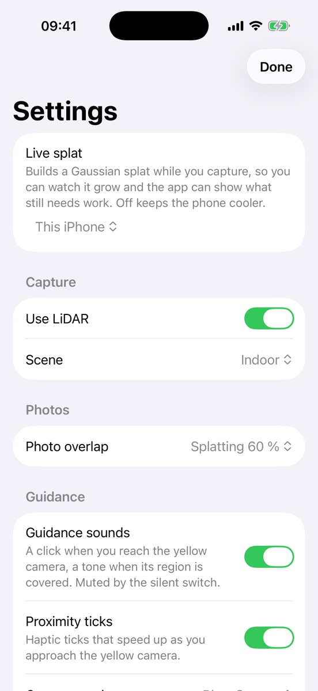

# Getting started

What you need, how the camera screen is laid out, and your first capture.

## Requirements

- An iPhone with iOS 18 or newer. Capture Guide was tested on an iPhone 14 Pro.
- A LiDAR sensor is optional. With LiDAR, the app saves a depth map (a distance for each pixel) with each photo it keeps and draws grey hatching over surfaces the reconstruction does not cover yet. Without LiDAR the capture still works, without those two. On a phone without the sensor, "Use LiDAR" in Settings is greyed out.

## Install

!!! note "Coming soon"
    Capture Guide will be available through TestFlight or the App Store. The links will appear here.

Capture Guide opens straight into the camera, so iOS asks for camera access the first time the camera starts. iOS also asks whether the app may use the local network. The app uses it only to look for a Mac running the planned companion app; building the 3D model on this iPhone does not need it.

The first time you tap Record, iOS asks for your location. The app saves where a capture was made, so it can name the capture after the place and show it on a map. Recording starts right away, whatever you answer.

## The camera screen

{ loading=lazy }
/// caption
Screenshot pending: the camera screen before recording, with the side rail on the right, the "Splat: iPhone" chip above the Record button, the newest capture at the bottom left and the gear at the bottom right.
///

- **Record**, at the bottom in the middle, starts a capture. Nothing is saved before you tap it.
- **The Live splat chip** above Record shows where the 3D model is built while you capture, for example "Splat: iPhone". The model is made of many splats, tiny blobs of colour. Tap the chip to change where it is built.
- **Your captures**: the picture at the bottom left shows your newest capture. Tap it to see all of them. It appears after your first capture.
- **Settings**: the gear at the bottom right.
- **The side rail** on the right edge has one button per guidance layer. A white disc behind a button means that layer is on. [Reading the guidance](guidance.md#the-side-rail) lists the buttons.

The controls on the camera screen stay dark, also when your iPhone is set to Light Mode, as in the Camera app.

## Your first capture

The phone builds the 3D model itself, so you need no other device.

1. Open Capture Guide. While the screen reads "Preparing splat engine…", the app tunes its engine for your phone. The camera appears when it is ready.
2. Leave the chip on "Splat: iPhone".
3. Tap Record. A pill at the top shows the tracking state and a count, for example "Tracking · 0 frames". The number counts keyframes, the photos the app keeps.
4. Walk slowly and keep the camera on the scene. Each time the app takes a keyframe, a white border flashes once around the screen. [Capturing a scene](capturing.md) explains how to walk.
5. Follow the guidance. A white ring around the Stop button fills as more of the scene is covered; it appears once the phone has a first coverage figure. [Reading the guidance](guidance.md) explains each part.
6. When "Room covered" appears, or when you have everything you want, tap Stop.
7. The capture opens. While the phone still writes the 3D model, the button at the bottom reads "Saving splat…". Then it reads "Done", and the line above it says what was saved, for example "Saved with splat".
8. Tap Done to go back to the camera. The capture stays on the phone: open it from the picture at the bottom left, or find it in the Files app. [Your captures and exporting](exporting.md) shows what you can do with it.

{ loading=lazy }
/// caption
Screenshot pending: the camera screen while recording, with the status pill and the guidance line at the top, the quality dots on the scene, the round map at the bottom left and the ring around the Stop button.
///

## Settings

Tap the gear, or the Live splat chip. Settings that change how the camera runs can't be changed during a capture; they read "Stop to change." until you tap Stop.

- **Live splat**: where the 3D model is built while you capture.
    - "This iPhone" is the default. If the phone cannot start its engine, the chip adds "(unavailable)".
    - "Mac" is for the planned Mac companion app. Macs found on your network appear in a list, and you can type an address. If no Mac answers within a few seconds, the capture runs without a 3D model and the chip adds "(not found)".
    - "Off" builds no 3D model and keeps the phone cooler. The guidance still works, without the grey hatching.
- **Use LiDAR**: on by default on phones with the sensor.
- **Scene**: "Indoor" or "Outdoor". Outdoor trains the model with a sky background and uses larger cells, for scenes that reach far away.
- **Photo overlap**: how much of its view a new keyframe may share with the one before. "Splatting 60 %" is the default. "SfM-safe 72 %" takes more photos, which suits photogrammetry software.
- **Guidance sounds** and **Proximity ticks**: see [Guidance sounds and taps](guidance.md#guidance-sounds-and-taps).
- **Coverage colours**: the colours of the quality dots and the map. "Blue-Orange" is the default; "Cividis" runs from dark blue to yellow.

{ width="320" loading=lazy }
/// caption
Settings; some rows explain themselves in a grey second line.
///

!!! info
    A Mac companion app is planned. Capture Guide does not need it.
