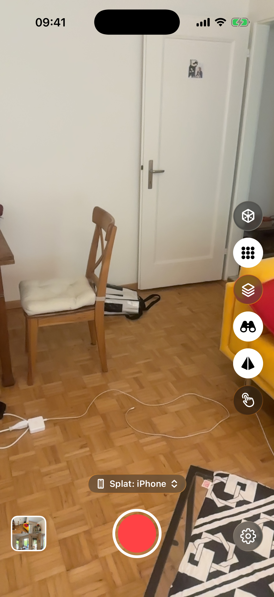
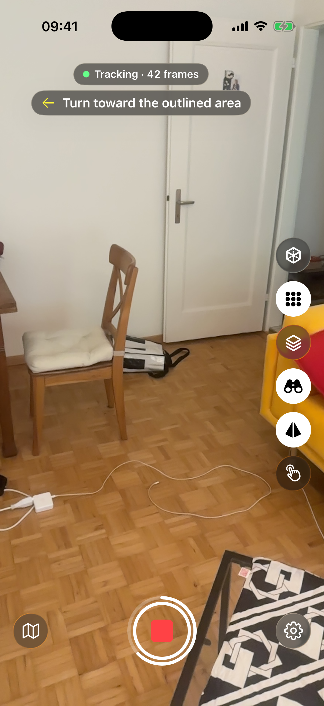
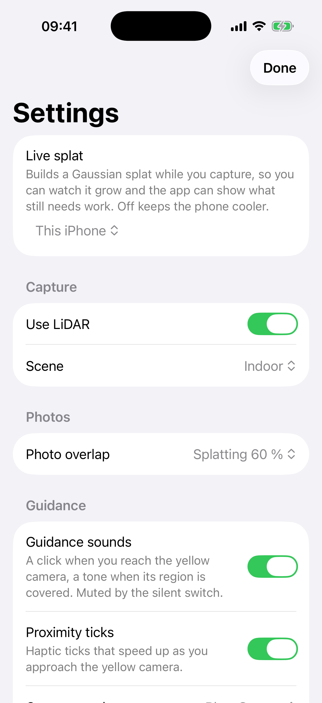

# Getting started

What you need, how the camera screen is laid out, and your first capture.

## Requirements

- An iPhone with iOS 18 or newer. Capture Guide was tested on an iPhone 14 Pro.
- Optional: a LiDAR sensor. It adds a depth map (a distance for each pixel) to each photo the app keeps, and grey hatching over surfaces the reconstruction does not cover yet. The capture works without it.

## Install

!!! note "Coming soon"
    Capture Guide will be available through TestFlight or the App Store. The links will appear here.

iOS asks for three permissions on first use:

- **Camera**: as soon as the app opens, since it starts on the camera.
- **Local network**: only used to look for a Mac running the planned companion app. Building the 3D model on this iPhone does not need it.
- **Location**: the first time you tap Record. The app names a capture after the place and shows it on a map. Recording starts right away, whatever you answer.

## The camera screen

Capture Guide opens on the camera, and nothing is saved until you tap Record. Like the Camera app, the controls stay dark even in Light Mode.

<figure class="callouts" markdown>

1. [**Side rail**](guidance.md#the-side-rail): one button per guidance layer. White disc means on.
   { data-anchor="rail" data-side="r" }
2. [**Live splat chip**](#live-splat): where the 3D model is built. Tap to change.
   { data-anchor="chip" data-side="r" }
3. [**Your captures**](exporting.md#your-captures): your newest capture. Tap it to see all.
   { data-anchor="captures-tile" data-side="l" }
4. [**Record**](#your-first-capture): starts a capture.
   { data-anchor="record" data-side="l" }
5. [**Settings**](#settings): the gear.
   { data-anchor="gear" data-side="r" }

</figure>

??? note "Details"
    - The chip reads, for example, "Splat: iPhone". The 3D model is made of many splats, tiny blobs of colour.
    - The picture of your newest capture appears after your first capture.

## Your first capture

The phone builds the 3D model itself, so you need no other device.

1. Open Capture Guide. While it reads "Preparing splat engine…", the app tunes its engine for your phone.
2. Leave the chip on "Splat: iPhone" and tap **Record**.
3. Walk slowly with the camera on the scene. A white border flashes each time the app keeps a photo (a keyframe). See [Capturing a scene](capturing.md).
4. Follow the guidance, explained in [Reading the guidance](guidance.md).
5. Tap **Stop** when "Room covered" appears, or when you have everything you want.
6. The capture opens. When the button at the bottom changes from "Saving splat…" to "Done", tap it to go back to the camera.
7. The capture stays on the phone. Open it from the picture at the bottom left, or find it in the Files app. See [Your captures and exporting](exporting.md).

<figure class="callouts" markdown>

1. [**Status pill**](capturing.md#keyframes): tracking state and the number of keyframes.
   { data-anchor="status-pill" data-side="l" }
2. [**Guidance line**](guidance.md#next-view-target): what to do next.
   { data-anchor="guidance-line" data-side="r" }
3. [**Side rail**](guidance.md#the-side-rail): guidance layers on and off.
   { data-anchor="rail" data-side="r" }
4. [**Map button**](guidance.md#minimap): brings back the round map.
   { data-anchor="map-button" data-side="l" }
5. [**Stop**](guidance.md#progress-ring): ends the capture. Its ring fills with coverage.
   { data-anchor="stop" data-side="l" }
6. [**Settings**](#settings): some rows are locked while you record.
   { data-anchor="gear" data-side="r" }

</figure>

??? note "Details"
    - The camera appears once the splat engine is ready.
    - The pill reads, for example, "Tracking · 0 frames"; the number counts keyframes.
    - The white ring around Stop appears once the phone has a first coverage figure, and fills as more of the scene is covered.
    - After saving, the line above "Done" says what was saved, for example "Saved with splat".

## Settings

Open Settings with the gear or the Live splat chip. Rows that change how the camera runs read "Stop to change." during a capture. Some rows explain themselves in a grey second line.

<figure class="callouts" markdown>

1. [**Live splat**](#live-splat): where the 3D model is built.
   { data-anchor="live-splat" data-side="r" }
2. [**Use LiDAR**](#requirements): on by default; greyed out without the sensor.
   { data-anchor="use-lidar" data-side="r" }
3. [**Scene**](#other-settings): "Indoor" or "Outdoor".
   { data-anchor="scene" data-side="r" }
4. [**Photo overlap**](#other-settings): how much a new keyframe may share with the last.
   { data-anchor="photo-overlap" data-side="r" }
5. [**Guidance sounds**](guidance.md#guidance-sounds-and-taps): a click and a tone for the targets.
   { data-anchor="guidance-sounds" data-side="r" }
6. [**Proximity ticks**](guidance.md#guidance-sounds-and-taps): taps that speed up near the yellow camera.
   { data-anchor="proximity-ticks" data-side="r" }

</figure>

### Live splat

- **This iPhone** (default): the phone builds the 3D model while you capture.
- **Mac**: for the planned Mac companion app, which Capture Guide does not need. Pick a Mac found on your network, or type an address.
- **Off**: no 3D model, and the phone stays cooler. The guidance still works, without the grey hatching.

??? note "Details"
    - If the phone cannot start its engine, the chip adds "(unavailable)".
    - If no Mac answers within a few seconds, the capture runs without a 3D model and the chip adds "(not found)".

### Other settings

- **Scene**: pick "Outdoor" for scenes that reach far away. It trains the model with a sky background and uses larger cells.
- **Photo overlap**: keep "Splatting 60 %", the default. "SfM-safe 72 %" takes more photos, which suits photogrammetry software.
- **Coverage colours**, under Guidance: the colours of the quality dots and the map. "Blue-Orange" is the default; "Cividis" runs from dark blue to yellow.
