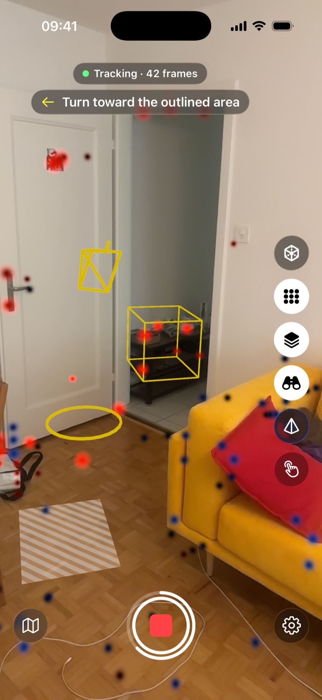
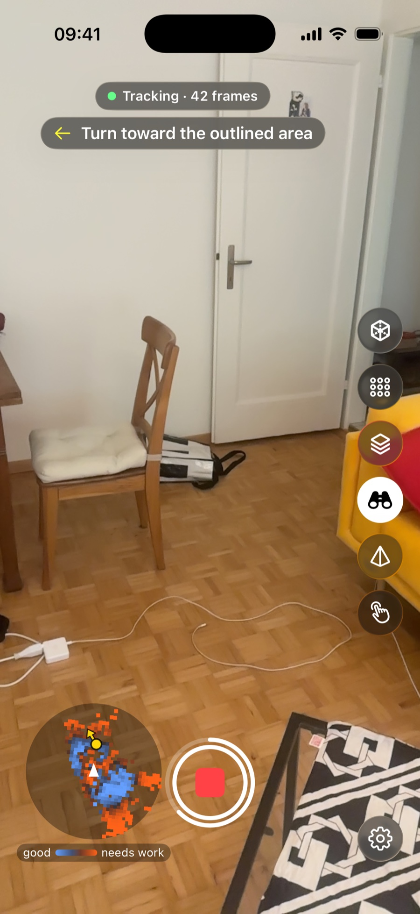
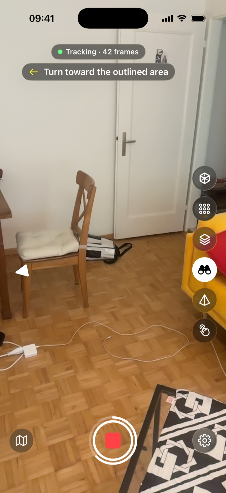
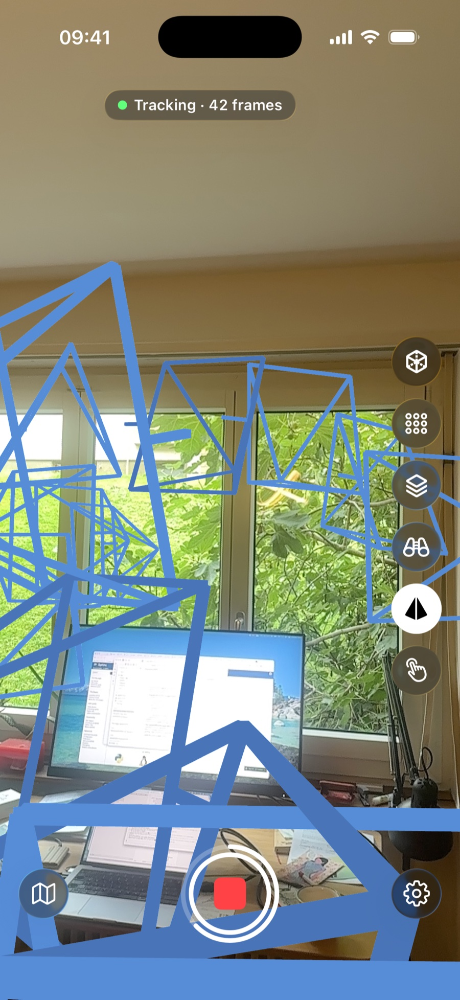
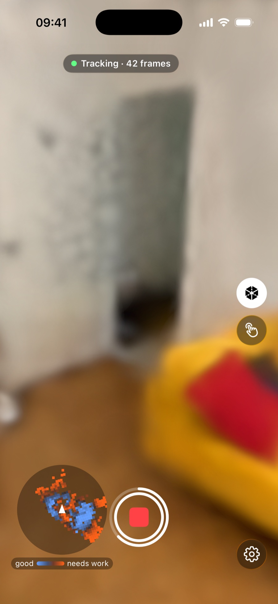

# Reading the guidance

What the on-screen guidance tells you while you capture, and what to do about each part.

The phone keeps its own map of the surfaces it has seen and how well your photos cover them. With Live splat on "This iPhone", it also trains a rough 3D model as you walk. The first dots and hatching show up a little while after you tap Record, once there is something to judge. With Live splat set to "Off", everything below still works except the grey hatching and the 3D model.

## Overlays in the room

<figure class="callouts" markdown>

1. [**Guidance line**](#the-guidance-line): what to do next.
   { data-anchor="guidance-line" data-side="r" }
2. [**Yellow camera**](#next-view-target): where to stand for the next view.
   { data-anchor="target-camera" data-side="l" }
3. [**Outlined area**](#next-view-target): what to point the phone at.
   { data-anchor="target-box" data-side="r" }
4. [**Weak dot**](#quality-dots): a spot that still needs work.
   { data-anchor="dot-weak" data-side="l" }
5. [**Floor ring**](#next-view-target): under the yellow camera, where you stand.
   { data-anchor="target-ring" data-side="l" }
6. [**Good dot**](#quality-dots): a spot your photos already cover well.
   { data-anchor="dot-good" data-side="l" }
7. [**Grey hatching**](#grey-hatching): surface the reconstruction has not reached yet.
   { data-anchor="hatch" data-side="l" }

</figure>

## Controls

<figure class="callouts" markdown>

1. [**Splat view**](#splat-view): the 3D model instead of the camera image.
   { data-anchor="rail-splat" data-side="r" }
2. [**Quality dots**](#quality-dots): the dots on or off.
   { data-anchor="rail-dots" data-side="r" }
3. [**Hatch**](#grey-hatching): the grey hatching on or off.
   { data-anchor="rail-hatch" data-side="r" }
4. [**Next-view targets**](#next-view-target): the yellow camera and its area on or off.
   { data-anchor="rail-targets" data-side="r" }
5. [**Keyframe frustums**](#keyframe-frustums): the keyframe pyramids on or off.
   { data-anchor="rail-frustums" data-side="r" }
6. [**Manual capture**](capturing.md#keyframes-by-hand): take keyframes yourself.
   { data-anchor="rail-manual" data-side="r" }
7. [**Stop**](#progress-ring): ends the capture; its ring shows coverage.
   { data-anchor="stop" data-side="r" }
8. [**Minimap**](#minimap): the area around you, seen from above.
   { data-anchor="minimap" data-side="l" }

</figure>

## Next-view target

The app picks one weak area at a time. Go to the yellow camera and face the outlined area; close to the camera, a ring appears at the area itself. Once you are in position, a keyframe is taken (or you tap the shutter) and the next target follows.

<figure class="callouts" markdown>

1. [**Edge arrow**](#next-view-target): a white arrowhead pointing to the off-screen yellow camera.
   { data-anchor="edge-arrow" data-side="l" }

</figure>

??? note "Details"
    - You are in position within about 0.5 m of the yellow camera, looking roughly at the area.
    - With automatic keyframes on, the app then takes the keyframe by itself; you feel a tap and hear a click. With manual capture, tap the shutter button yourself.
    - A target ends in one of four ways:
        - A keyframe is taken while you are in position. You hear a tone and feel a tap, "Captured" shows, and the next target follows.
        - Other photos you take cover the area first.
        - You do not approach for about 20 s. The app drops the target and may offer another.
        - Another area becomes clearly more important.
    - No target shows during the first 20 s of a segment.
    - Targets need the "Next-view targets" button on (it is on by default) and a running capture. They pause in the splat view.

### The guidance line

The line under the status pill, and under any banners, shows one of these:

- "Stand at the yellow camera and point it at the outlined area": still far from it.
- "Point at the outlined area": at the camera, facing elsewhere.
- "Turn toward the outlined area": the same, arrow shows which way.
- "Good — hold steady": in position; the target turns green.
- "Captured": target done; stays a second.
- "Keep scanning — the next view appears shortly": weak areas left, no target yet.
- "Room covered", in green: no weak area left.

When "Room covered" shows, you can stop, or carry on if you want a denser capture.

## Guidance sounds and taps

A click tells you that you reached the yellow camera, and a tone that its area is covered; you feel a tap each time as well. "Proximity ticks" are soft taps that come faster as you get nearer to the yellow camera, like a parking sensor. The "Guidance sounds" and "Proximity ticks" switches in Settings, under Guidance, turn them off.

??? note "Details"
    - "Guidance sounds" covers the click and the tone. The taps on arrival and completion do not depend on it.
    - The phone's silent switch mutes the sounds as well, and music or podcasts keep playing underneath.
    - Proximity ticks stop once you are in position.

## Quality dots

The dots lie on the surfaces the phone knows. With the default colours, "Blue-Orange", light blue is well covered, the colour darkens as coverage gets worse, and orange needs work. Walk towards the weak dots and look at them from a new side; moving sideways helps more than turning on the spot, as [Capturing a scene](capturing.md#angles) explains. Walk around a surface rather than along it to fill corners and edges.

??? note "Details"
    - A spot gets full marks once the phone has seen it from 3 clearly different directions and from close enough at least once. Fewer directions, or only distant photos, leave the dot towards orange.
    - Different directions: at least 25° apart. Standing 2 m from a wall, about 1 m sideways gives a new direction. Turning on the spot gives none.
    - Close enough: within about 2 m with the main camera, about 1 m with the ultra-wide.
    - The colours change as the phone takes new keyframes.
    - "Coverage colours" in Settings switches the colour scheme. The map legend always shows the one you picked, from "good" to "needs work".
    - The guidance keeps working with the dots turned off.

## Grey hatching

The grey diagonal stripes lie over a faint grey fill, on surfaces the LiDAR sensor has found. Point the camera at them; they disappear as the reconstruction catches up.

??? note "Details"
    - Hatched means the reconstruction has nothing within about 10 cm of the surface.
    - Hatching needs LiDAR and a Live splat setting other than "Off".
    - It stays off until the first reconstruction exists.

## Keyframe frustums

The colour of each pyramid tells you how well that keyframe is tied to the others, from "needs work" to "good". Where pyramids sit at the "needs work" end, add views in between and around them, so each keyframe shares more of its view with its neighbours.

<figure class="callouts" markdown>

1. [**Keyframe frustum**](#keyframe-frustums): a keyframe's place, pointing the way the camera looked.
   { data-anchor="frustum" data-side="l" }

</figure>

??? note "Details"
    - The colour is the share of a keyframe's view that another keyframe also sees: "needs work" at 0 %, "good" at the overlap your [Matcher](getting-started.md#other-settings) sets (60 % by default).
    - A white pyramid means the app cannot judge that keyframe yet.
    - A new segment clears them, because the old coordinate system is gone.
    - They are on by default.

## The side rail

The buttons on the right edge are named in the [Controls](#controls) figure. A white disc behind a button means on; a plain white symbol means off.

??? note "Details"
    - The Splat view button appears once the phone has built part of the 3D model, with Live splat on "This iPhone".
    - The Hatch button appears when the phone uses LiDAR (a phone with the sensor and "Use LiDAR" on in Settings) and Live splat is not "Off".

## Splat view

In the splat view the other layers are hidden. Where the model has nothing yet, the screen stays black; gaps and thin areas are places it has not learned. Switch it on for a quick look, then off again to carry on with the guidance.

<figure class="callouts" markdown>

1. [**3D model**](#splat-view): what the phone has built so far.
   { data-anchor="splat-view" data-side="l" data-at="center" }
2. [**Splat view button**](#the-side-rail): on; tap again for the camera image.
   { data-anchor="rail-splat" data-side="r" }
3. [**Manual capture**](capturing.md#keyframes-by-hand): the only other button left.
   { data-anchor="rail-manual" data-side="r" }
4. [**Minimap**](#minimap): stays in the splat view.
   { data-anchor="minimap" data-side="l" }

</figure>

## Progress ring

The filled part of the white ring around Stop is the share of the known surface seen from at least 3 clearly different directions, with at least one photo from close enough. It grows as you fill gaps; the [quality dots](#quality-dots) show which spots still need work. Use it to judge how far along you are. Walk around surfaces and look at them from new sides to fill it.

??? note "Details"
    - The ring appears a little after you start, once the phone has its first coverage figure.
    - "Different directions" and "close enough" mean the same as for the [quality dots](#quality-dots).
    - After a quick walk through the room in one pass, the ring often stays well below half.
    - It rarely reaches the full circle: corners you cannot reach and surfaces seen from one side keep it below that.
    - When a new segment starts, the ring disappears until the new segment has its own figure.

## Minimap

The round map looks down on the area around you: your view direction points up, and the white triangle in the middle is you. Its squares are coloured like the dots, so it shows weak spots even behind you, and a yellow dot marks the next-view target. Small white wedges mark where you took keyframes and which way the camera looked, so you see which sides you have already photographed. Use it to pick where to walk; the target and dots show the details. Tap the map to hide it; a round map button takes its place and brings it back.

??? note "Details"
    - The map covers 5 m around you. Each small square is a patch of known surface, with the legend "good" and "needs work" under the map.
    - The yellow dot has a short arrow towards the area to point at. If the yellow camera is more than 5 m away, the dot sits on the rim.
    - A keyframe taken looking almost straight up or down shows as a small white dot instead of a wedge.
    - A new segment clears the wedges, because the old coordinate system is gone.
