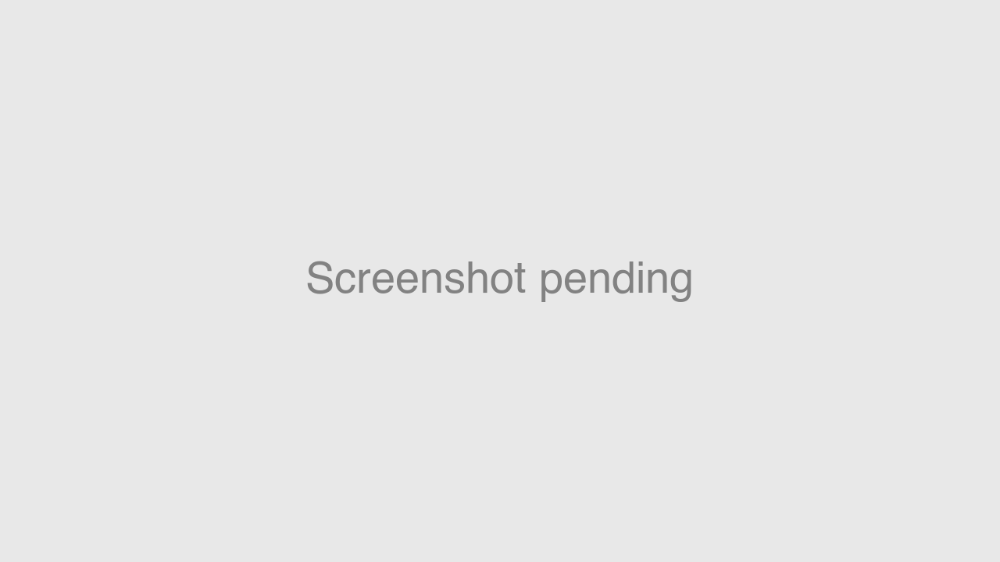
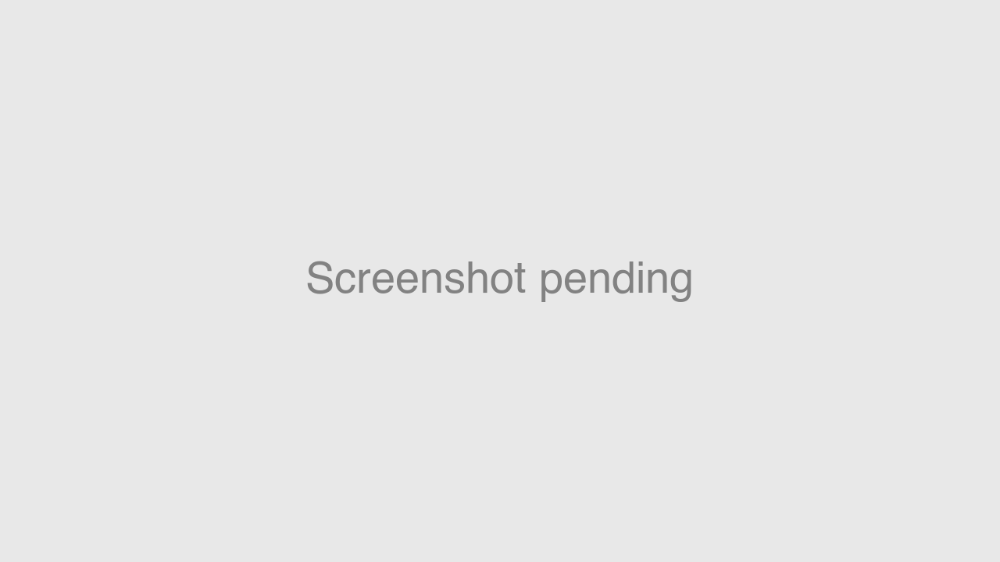
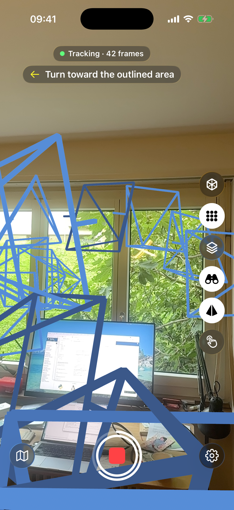

# Reading the guidance

What the on-screen guidance tells you while you capture, and what to do about each part.

Most of it is drawn over the camera image. The phone keeps its own map of the surfaces it has seen and how well your photos cover them, and with Live splat on "This iPhone" it also trains a rough 3D model as you walk. The first dots and hatching show up a little while after you tap Record, once there is something to judge. With Live splat set to "Off", the dots, the map, the progress ring and the next-view targets still work; only the grey hatching and the 3D model are missing.

## The side rail

The buttons on the right edge switch the guidance layers on and off. A white disc behind a button means on; a plain white symbol means off. From top to bottom:

- **Splat view** (a cube): shows the 3D model instead of the camera image. It appears once the phone has built part of the model, with Live splat on "This iPhone". See [Splat view](#splat-view).
- **Quality dots** (a grid of dots). See [Quality dots](#quality-dots).
- **Hatch** (stacked layers): the grey hatching. It appears when the phone uses LiDAR (a phone with the sensor and "Use LiDAR" on in Settings) and Live splat is not "Off". See [Grey hatching](#grey-hatching).
- **Next-view targets** (binoculars). See [Next-view target](#next-view-target).
- **Keyframe frustums** (a pyramid). See [Keyframe frustums](#keyframe-frustums).
- **Manual capture** (a hand). See [Keyframes by hand](capturing.md#keyframes-by-hand).

While the splat view is on, only the splat view and manual capture buttons stay.

At the larger accessibility text sizes, touch and hold a button to see it enlarged with its name.

{ loading=lazy }
/// caption
Screenshot pending: the side rail on the right edge, with quality dots, next-view targets and keyframe frustums on (white discs) and the hatch and manual capture off.
///

## Progress ring

**What you see.** While you record, a white ring around the Stop button fills up. It appears a little after you start, once the phone has its first coverage figure.

**What it means.** The filled part is the share of the known surface that is nearly fully covered: the surface is split into small patches, and a patch counts once its coverage is above 80% ([Quality dots](#quality-dots) explains coverage). The ring grows as you fill gaps. When a new segment starts, the ring disappears until the new segment has its own figure. With VoiceOver on, the Stop button reads the figure, for example "63 % covered".

**What to do.** Use it to judge how far along you are. It rarely reaches the full circle: corners you cannot reach and surfaces seen from one side keep it below that. "Room covered" in the guidance line is the better sign that you are done.

{ loading=lazy }
/// caption
Screenshot pending: the Stop button with its white ring about two-thirds filled.
///

## Quality dots

**What you see.** Small dots floating over the scene, on the surfaces the phone knows. With the default colour scheme, "Blue-Orange", a light blue dot is well covered, the colour turns darker as coverage gets worse, and orange means the spot needs work. The map legend ([below](#minimap)) always shows the scheme you picked, from "good" to "needs work".

**What it means.** A spot gets full marks when the phone has seen it in about 8 photos, taken from a spread of directions, with at least one of them close enough to show it sharply. Fewer photos, or photos from one side only, leave the dot towards orange. The colours change as the phone takes new keyframes.

**What to do.** Walk towards the orange dots and look at them from a new side. Moving sideways helps more than turning on the spot, for the reasons given in [Capturing a scene](capturing.md#angles).

Turn the dots off with the "Quality dots" button on the side rail; the guidance keeps working either way. "Coverage colours" in Settings switches the colour scheme.

{ loading=lazy }
/// caption
Screenshot pending: a room in the camera view with quality dots, light blue on a well-covered wall and orange on a weakly covered corner, with the ring around the Stop button visible.
///

## Splat view

**What you see.** With the "Splat view" button on, the camera image and the other layers give way to the 3D model itself on black, so you can see what the phone has built so far. The map stays.

**What it means.** Gaps and thin areas in the splat view are places the model has not learned yet.

**What to do.** Switch the splat view on for a quick look, then off again to carry on with the guidance. While it is on, next-view targets are paused.

{ loading=lazy }
/// caption
Screenshot pending: the splat view of a partly built room on black, with the "Splat view" button on (white disc) in the side rail.
///

## Grey hatching

**What you see.** Grey diagonal stripes over a faint grey fill, lying on the surfaces the sensor has found.

**What it means.** The LiDAR sensor has found a surface here, but the reconstruction has nothing within about 10 cm of it yet. Hatching needs LiDAR and a Live splat setting other than "Off". It also stays off until the first reconstruction exists, so you do not see it in the first moments of a capture.

**What to do.** Point the camera at the hatched surfaces. The stripes disappear as the reconstruction catches up.

{ loading=lazy }
/// caption
Screenshot pending: grey diagonal hatching on part of a wall and floor, with the already reconstructed part of the same wall free of it.
///

## Keyframe frustums

**What you see.** A thin outline of a pyramid at every place where the app took a keyframe, pointing the way the camera looked. It is on by default.

**What it means.** The colour tells you how well that keyframe is tied to the others: it runs from "needs work" at 0% to "good" at 72%, the share of its view that another keyframe also sees. A white pyramid means the app cannot judge that keyframe yet. A new segment clears them, because the old coordinate system is gone.

**What to do.** Where pyramids sit at the "needs work" end, add views in between and around them, so each keyframe shares more of its view with its neighbours.

Switch them with the "Keyframe frustums" button on the side rail. Like the dots and the hatching, they are hidden in the splat view.

{ loading=lazy }
/// caption
Screenshot pending: pyramid outlines along a walked path, most of them blue and one or two orange where keyframes are far apart.
///

## Next-view target

**What you see.** A yellow camera shape in the room, with a ring on the floor under it, and an outlined box around the area to capture. When you are close to the yellow camera, a ring appears at the area itself. If the yellow camera is outside the screen, a white arrowhead near the screen edge points towards it.

A line near the top, under the status pill and any banners, tells you what to do next. These are the lines, as they appear:

- "Stand at the yellow camera and point it at the outlined area": you are still far from it.
- "Point at the outlined area": you are at the yellow camera but not yet looking the right way.
- "Turn toward the outlined area": the same, with an arrow showing which way to turn.
- "Good — hold steady": you are in position, and the whole target turns green.
- "Captured": the target is done. It stays for a second.
- "Keep scanning — the next view appears shortly": weak areas remain, but there is no target to show right now.

"Room covered" appears in green in the same place when no weak area is left.

**What it means.** The app picks one weak area at a time and shows you where to stand to fix it. You are in position when you are within about half a metre of the yellow camera and looking roughly at the area. With automatic keyframes on, the app then takes a keyframe by itself, you feel a tap, and you hear a click. If you use manual capture, tap the shutter button yourself.

A target ends in one of four ways:

- A keyframe is taken while you are in position. You hear a tone and feel a tap, "Captured" shows, and the next target follows.
- Other photos you take cover the area first.
- You do not approach for about 20 seconds. The app drops the target and may offer another.
- Another area becomes clearly more important.

No target shows during the first 20 seconds of a segment. Targets also need the "Next-view targets" button on (it is on by default) and a running capture, and they pause in the splat view.

**What to do.** Walk to the yellow camera and point the phone at the outlined area. When "Room covered" shows, you can stop, or carry on if you want a denser capture.

{ loading=lazy }
/// caption
Screenshot pending: a room with the yellow camera shape, the ring on the floor below it, the outlined box on a wall, and the instruction line "Stand at the yellow camera and point it at the outlined area" under the status pill.
///

## Guidance sounds and taps

Two short sounds go with the targets: a click when you reach the yellow camera, and a tone when its area is covered. The "Guidance sounds" switch in Settings, under Guidance, turns them off. The phone's silent switch mutes them as well, and music or podcasts keep playing underneath. The taps you feel on arrival and on completion do not depend on that switch.

"Proximity ticks" are soft taps that come faster as you get nearer to the yellow camera, like a parking sensor, and stop once you are in position. Turn them off in the same section of Settings.

## Minimap

**What you see.** A round map at the bottom left, looking down from above. Your view direction always points up, and a white triangle in the middle is you. The map covers 5 metres around you. Each small square is a patch of known surface, coloured like the dots, with the legend "good" and "needs work" under it. A yellow dot marks the next-view target, with a short arrow towards the area to point at. If the yellow camera is more than 5 metres away, the dot sits on the rim.

**What it means.** It shows where around you coverage is still weak, including the spots behind you.

**What to do.** Use it to decide where to walk next, then use the target and the dots for the details. Tap the map to hide it; a round map button takes its place. Tap that to bring the map back.

{ loading=lazy }
/// caption
Screenshot pending: the round minimap at the bottom left with blue and orange squares, the white triangle in the middle, the yellow target dot with its arrow, and the "good" and "needs work" legend.
///
